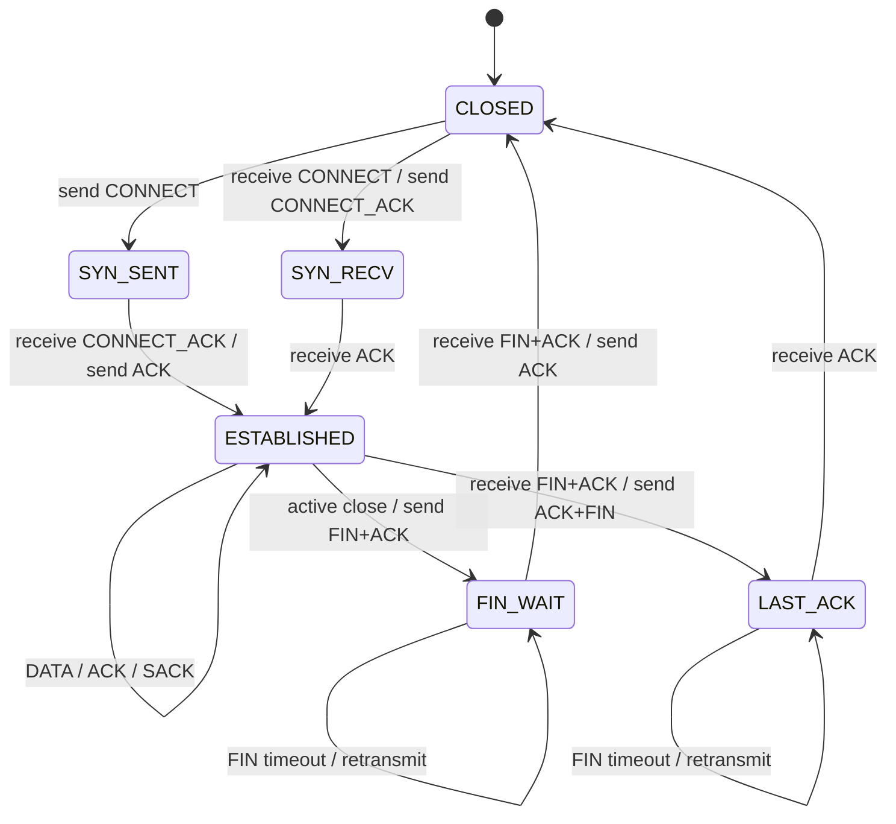

# SSCP (Simple Stream Control Protocol)

[中文说明](docs/中文/README中文.md)

SSCP is a compact, stream-oriented reliable transport protocol implemented over UDP in clean C. It provides reliable delivery, flow control, connection management, congestion control, and pacing without depending on kernel TCP or external libraries.

## Motivation

Why did I start this project? Sometimes it begins with a tiny spark of an idea, and looking back, you've already walked a very long way.

Initially, I just felt that TCP was way too bloated, and mechanisms like AIMD relying purely on packet loss as a congestion signal were very bad. I believed I could do better, so I started my research into network transport protocols, hahaha! Maybe I won't end up designing a better protocol, but the exploration itself is the real fun! Hhha, just for fun!

## Real-World Deployments & Experimental Validation

SSCP is strictly decoupled from underlying packet transports, and I have conducted extensive testing and experiments across many scenarios:

- **Microcontrollers**: In an early prototype, I ported the protocol to an STM32F103C8T6 MCU with only 20 KB of SRAM. To be completely candid, running a full streaming protocol with window control and retransmission state machines on an MCU is complete overkill ("using a sledgehammer to crack a nut"). But I just wanted to see if it could even run. Surprisingly, it ran remarkably well—not only could it run, but it could even run the operating system and programming language I wrote. Later, I used it directly for data transfer in another of my microcontroller distributed projects, where it performed smoothly.
- **Transcontinental Real-World WAN**: Repeatedly transferred 100 MB files between a local machine in China and a US VPS over public Internet routes across multiple experiments, thoroughly testing end-to-end data integrity and performance.
- **Intensive Linux & Netem Stress Testing**: Set up rigorous network namespace topologies using Linux `netem` qdiscs with bandwidth bottlenecks, round-trip propagation delays (RTT), and random packet loss, conducting large-scale, high-intensity transfer tests from hundreds of megabytes up to 1 GiB.

## Features

- Reliable byte stream over unreliable packet transports
- Sequence numbers, cumulative ACKs, and selective ACKs (SACK)
- Out-of-order buffering and retransmission
- Receiver-advertised flow-control window
- Smoothed RTT, RTT variance, and dynamic RTO estimation
- Full CONNECT and FIN connection lifecycle
- Pluggable congestion control: SSCP-PROB and AIMD baseline
- Sender-side pacing based on `cwnd / RTT`
- Intrusive red-black trees for timers and out-of-order buffers
- Clean C implementation with no external runtime dependencies

## Connection State Machine



## Congestion Control and Pacing

- **SSCP-PROB**: Combines smoothed loss rate with RTT inflation to produce a continuous congestion signal, driving nonlinear window adjustments.
- **AIMD**: Standard additive-increase, multiplicative-decrease controller used as a baseline.
- **Pacing**: Dispatches packets admitted by `cwnd` using per-packet intervals derived from RTT and `cwnd`. Batches start at `max(next_slot, now)` and preserve pacing intervals across empty queue states.

## Quick Start

### 1. Build

```sh
cmake -S test -B test/build -DCMAKE_BUILD_TYPE=Release
cmake --build test/build -j
```

### 2. Run Tests

```sh
# Virtual network suite (11/11 tests)
ctest --test-dir test/build -L virtual --output-on-failure

# Paired localhost UDP transfer
python3 test/run.py test/build/sscp_udp --bytes 8388608 --out test/results/udp-test
```

### 3. Linux Namespace Impairment Experiments

```sh
# Setup 5 Mbps, 50 ms delay, 10% loss topology
sudo bash setup_sscp_netns.sh setup 5mbit 50ms 10% 1000

# Terminal 1 (Receiver B):
sudo ip netns exec sscp-s test/build/sscp_udp B 10.0.2.1 104857600 aimd

# Terminal 2 (Sender A):
sudo ip netns exec sscp-c test/build/sscp_udp A 10.0.2.1 104857600 aimd

# Teardown
sudo bash setup_sscp_netns.sh teardown
```

### 4. Trace Visualization with jPlot

jPlot was recommended by Sebastian Moeller and is a fantastic tool. I ran into lots of trouble using classic xplot, so I strongly recommend everyone use jPlot!

```sh
python3 test/sscptrace.py test/results/udp-test -o test/results/udp-test/trace.xpl
java -jar jPlot.jar test/results/udp-test/trace.xpl
```

## Documentation

- User Guide (English): [docs/English/UserGuide.md](docs/English/UserGuide.md)
- 使用手册 (中文): [docs/中文/使用手册.md](docs/中文/使用手册.md)
- Testing Guide (English): [test/README.md](test/README.md)
- 测试说明 (中文): [docs/中文/测试说明.md](docs/中文/测试说明.md)
- README (中文): [docs/中文/README中文.md](docs/中文/README中文.md)

## Contributing

Issues and pull requests are welcome for bug reports, questions, and protocol discussions.

## License

SSCP is released under the [MIT License](./LICENSE).
