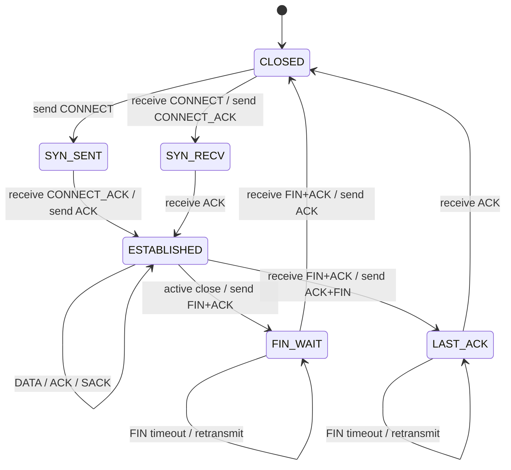

# SCP (Simple Stream Control Protocol)

> **Next-slot slow-start research branch.** This campaign reruns the fixed-100 ms,
> zero-loss gain study with the reviewed Q16 gain callbacks and next-slot scheduler.
> See the [experiment code, review map and reproduction steps](test/research/README.md).
> New results are pending; the papers below describe earlier experiments.

[中文说明](./docs/中文/README中文.md)

SCP is a compact, stream-oriented reliable transport protocol implemented over UDP or another unreliable packet transport. The project focuses on network transport research: exploring reliable delivery, congestion control, pacing, and connection behavior with an inspectable C implementation.

SCP provides sequencing, ACK/SACK processing, retransmission, flow control, connection management, RTT/RTO estimation, and congestion control without depending on a kernel TCP stack. The project currently contains two interchangeable congestion controllers:

- **SCP-PROB**: an experimental nonlinear controller that converts loss and RTT evidence into a continuous congestion-likelihood signal.
- **AIMD**: a conventional additive-increase, multiplicative-decrease controller, also used as the baseline in comparative experiments.

The current implementation also includes a sender-side pacing layer. Packets admitted by the congestion window are assigned transmission times derived from `cwnd` and RTT, then released by the pacing timer.

> **Project status:** SCP is under active development; its API and wire format may change. The transport core and the selectable congestion controllers are evaluated separately. The PROB-specific experimental results are documented below.

## Research papers

The probability-driven controller is described in [SCP-PROB: Probability-Driven Nonlinear Congestion Control](./SCP-PROB_Probability-Driven_Nonlinear_Congestion_Control.pdf).

The pacing study, [Pacing Gain and Congestion-Window Growth: Packet Models and SCP Experiments](./Pacing_and_Congestion_Window_Growth.pdf), examines how scheduling changes window growth and packet spreading in slow start and congestion avoidance. It combines explicit packet models with separate campaigns through the SCP C implementation at fixed 100 ms feedback and zero loss. The CA study also measures the effect of integer-byte window updates. For Overleaf, upload [papers/pacing/](./papers/pacing/), including `figures/`, and compile `Pacing_and_Congestion_Window_Growth.tex` with pdfLaTeX.

| Research | Reproduction code and steps | Actions data |
|---|---|---|
| Slow start | [Frozen research branch](https://github.com/skaiui2/SCP/tree/research/slowstart-g-100ms-20261012/reproduction) | [Run 38893710287](https://github.com/skaiui2/SCP/actions/runs/38893710287) |
| Congestion avoidance | [CA guide and paper plotting script](https://github.com/skaiui2/SCP/tree/research/ca-g-100ms-20261018/reproduction/ca) | [Successful run 39122340171](https://github.com/skaiui2/SCP/actions/runs/39122340171) |

Download data from Actions artifacts; the historical slow-start Release archive was removed. If artifacts have expired, use the source-based rerun steps. Each research branch keeps its own reproduction material; this branch contains the common paper and these entry points.

## Features

- Reliable byte stream over an unreliable packet transport
- Sequence numbers, cumulative ACKs, and SACK information
- Out-of-order buffering and retransmission
- Receiver-advertised flow-control window
- RTT, RTT variance, and retransmission-timeout estimation
- CONNECT/FIN connection lifecycle
- Pluggable congestion-control callbacks
- Selectable PROB and AIMD congestion controllers
- Sender-side pacing based on `cwnd / RTT`
- Red-black trees for timers and out-of-order receive buffers
- Small C implementation intended to remain inspectable and portable

## Repository layout

```text
scp.c / scp.h                  protocol core
lib/                           intrusive containers and data structures
test/common/                   shared transfer logic and real UDP runner
test/virtual/                  virtual network, functional tests and sweeps
test/run.py                    paired transfers, validation and saved results
test/plot.py                   plotting entry point and sweep overview
test/analyze_scp.py / fig.py    original state-log analyzer and publication figures
.github/workflows/             Linux transfers and virtual-network CI
setup_scp_netns.sh             Linux network-namespace topology
papers/pacing/                 pacing manuscript source
docs/                          user documentation
```

## Connection state machine



## Congestion control and pacing

### SCP-PROB

SCP-PROB combines a smoothed loss estimate with RTT measurements to form a residual congestion signal. A calibrated sigmoid and hysteresis determine whether its nonlinear control law increases or decreases the window.

The design target is transmission in lossy or variable environments. In the zero-random-loss configuration reported below, two PROB flows received unequal shares, and PROB received a very small share when competing with AIMD. These observations concern the tested PROB controller and configuration; they do not establish a failure of the AIMD controller or SCP's reliable-transport mechanisms.

### AIMD

AIMD is an independently selectable congestion controller using conventional additive increase and multiplicative decrease. It uses the same congestion-control interface as SCP-PROB, while applying its own window-update rules. It also serves as the baseline in the experiments below.

### Pacing

The pacing layer does not replace the congestion window:

1. `cwnd` and the peer window determine how much data may enter the network.
2. The sender derives a per-packet interval from the current RTT and congestion window.
3. Packets receive increasing scheduled timestamps.
4. A 1 ms pacing timer sends every packet whose scheduled time has arrived.

Multiple packets may be released in one timer tick when their calculated interval is below 1 ms or when the process wakes up late. The pacing integration test measures calls to the real transport `send` callback; it does not claim to measure physical wire-departure time after qdisc.

### Pacing discussion notes

The analysis asks how pacing changes ACK timing and window growth, and how that behavior depends on the pacing gain. Relevant ICCRG threads record the questions and implementation details considered during the work:

- [Slow-start timing and comparison models](https://mailarchive.ietf.org/arch/msg/iccrg/K0LZfeCUDnp3Kj91dMx-0iPGef8/), including the distinction between [fixed-batch and per-ACK scheduling](https://mailarchive.ietf.org/arch/msg/iccrg/GSzlNebpiu6Gp1UTRZJISBRiIi8/) and [window limits versus pacing-rate limits](https://mailarchive.ietf.org/arch/msg/iccrg/6K-oKt8LfaaH1XQKzp62wfElujc/).
- [Why Linux uses a slow-start pacing multiplier of 2](https://mailarchive.ietf.org/arch/msg/iccrg/ms7Nww2LvUBuDaUmOD71osmp8bI/). [Neal Cardwell's reply](https://mailarchive.ietf.org/arch/msg/iccrg/ERsHqvYQLs7cNCxOPw13U5Jl9sg/) provides paced/unpaced CUBIC timing diagrams and the BBR Startup gain derivation. The [follow-up question](https://mailarchive.ietf.org/arch/msg/iccrg/a59n7DRXZr4q6it_djAZh23wuas/) examines the assumptions behind a continuous-model calculation of `2 ln 2` and its relation to Linux's multiplier of 2.

## Build and tests

One CMake configuration builds all tests. Real UDP and virtual-network tests share the generated-data transfer, checksum exchange and close verification. No payload files are needed.

```sh
cmake -S test -B test/build -DCMAKE_BUILD_TYPE=Release
cmake --build test/build -j
ctest --test-dir test/build --output-on-failure
python3 test/run.py test/build/scp_udp --out test/results/udp-1g
```

The default standalone transfer is 1 GiB. See [test instructions](test/README.md) for dependencies, file transfers, network sweeps, and fairness measurements.

### Current test system

- **Functional and integrity checks:** CTest registers 12 checks covering connection lifecycle, control-packet loss, allocation failure, closure, generated-data and file transfers, PROB/AIMD operation, pacing observations, and two-flow smoke checks.
- **Shared transfer logic:** real UDP and virtual-network runs use the same transfer implementation. Generated data is checked byte by byte and by stream checksum; file runs additionally compare file lengths and SHA-256 hashes. Both endpoints must complete closure.
- **Linux and virtual transfers:** GitHub Actions runs CTest, a 1 GiB virtual transfer, and a 1 GiB file transfer over Linux localhost UDP. The localhost run has no imposed WAN bandwidth or delay; Linux namespaces provide a separate controlled-network setup.
- **Network scenarios:** the default CI sweep runs 150 virtual cases: three 100 Mbps scenarios with base RTTs of 10, 50, and 200 ms, ten independent packet-loss rates from 0% to 5%, five seeds, and 64 MiB per run. Manual `scenarios-1g` runs 36 cases at 1 GiB. These are configured simulations; the simplified Wi-Fi case does not model contention or link-layer retries.
- **Inspectable results:** each parameter combination and connection retains its own protocol-state logs and plots using the original analyzer. Reports include failures and successful-run goodput statistics. Download `transfer-1g-curves` and `network-report` for figures and summaries; `transfer-1g-logs` and `network-shard-*` retain raw evidence separately for 14 days. See [test instructions](test/README.md) to rerun after expiration.

These tests provide evidence for the configurations exercised; they do not establish correctness for every network or turn simulation results into real-path measurements.

### Test architecture and environments

The harness separates the transfer workload from packet delivery. Both backends exercise the actual SCP core and reuse `test/common/transfer.c` for data generation, receive validation, checksum exchange, and closure. The virtual backend uses a seeded packet scheduler and simulated clock; the UDP backend uses sockets and real elapsed time. Python runners coordinate execution, retain diagnostics, and invoke the original plotting scripts on the core's JSON logs. The [test design and environment notes](test/README.md#test-design-and-environments) describe the layers and pass criteria.

| Environment | What it exercises |
|---|---|
| Virtual network | Repeatable rate, propagation delay, random loss, and protocol events without waiting for real elapsed time |
| Localhost UDP | Real sockets, Linux/Windows process scheduling, paired endpoints, and file I/O |
| Linux namespaces + netem | Real Linux UDP/IP and qdisc behavior on a controlled client–router–server path |
| Actual China-to-US path | Deployment experience on a real intercontinental route; separate from configured simulation scenarios |

Earlier netem experiments used `scp-c ↔ scp-r ↔ scp-s`, with a netem qdisc on each router egress. Each direction had its own rate, one-way delay, random loss, and finite packet queue. The historical results below used 5 Mbit/s per direction, 50 ms one-way delay (about 100 ms unloaded RTT), a 1000-packet queue, 100 MiB transfers, and 300-second fairness measurements. This exercises actual Linux networking under emulated impairments; it does not reproduce every feature of an Internet path. The current CI localhost transfer does not apply this netem topology, and the virtual model has no finite queue. Results from these environments should be reported separately.

For Linux namespaces, create the topology, then start B and A in separate terminals:

```sh
sudo bash setup_scp_netns.sh
sudo ip netns exec scp-s test/build/scp_udp B
sudo ip netns exec scp-c test/build/scp_udp A 10.0.2.1
```

## Earlier validation snapshot

The following results are a transparent snapshot from **2026-08-19**, not a multi-run benchmark or a general performance claim.

Environment:

```text
rate:             5 Mbit/s per direction
one-way delay:    50 ms
expected RTT:     approximately 100 ms
queue limit:      1000 packets
file size:        100 MiB
fairness period:  300 seconds
```

### Zero random loss

| Case | Observed result |
|---|---|
| PROB, single flow | 4.686 Mbit/s receiver goodput |
| AIMD, single flow | 4.746 Mbit/s receiver goodput |
| Pacing | 8 MiB verified; 2.200 ms average sender-callback gap; at most 4 DATA packets observed in one millisecond |
| PROB vs PROB | 4.735 Mbit/s total; Jain index 0.641; flow ratio 6.95:1 |
| PROB vs AIMD | 3.421 Mbit/s total; Jain index 0.504; PROB received 0.36% of delivered bytes |

The transferred 100 MiB file passed end-to-end hash verification.

### Ten percent random loss

| Case | Observed result |
|---|---|
| PROB vs PROB | 2.044 Mbit/s total; Jain index 0.999887; flow ratio 1.022:1 |

In this snapshot, the two PROB flows had near-equal shares at 10% random loss and unequal shares at zero random loss; aggregate goodput was lower in the loss case. PROB's allocation behavior and coexistence with AIMD need further investigation. The tables report controller-specific throughput and sharing separately from the transport's file-integrity checks.

In test output, `"status":"success"` records successful case execution and the applicable protocol/integrity checks. Throughput and fairness are reported as separate measurements.

## Analysis

Test builds enable the protocol's own JSON state printer, sampled every 100 ms.
`test/run.py` saves logs and plots automatically (requires matplotlib). Real Linux
file transfer and virtual-network runs are separate:

```sh
sudo python3 test/run.py test/build/scp_udp --netns --file testA.bin --timeout 3600 --out test/results/linux-file
python3 test/run.py test/build/scp_virtual --backend virtual --out test/results/virtual-1g
```

Create the namespace topology before the file run. The file test writes
`received.bin`, checks both files' SHA-256 and saves endpoint logs and curves.
See [test instructions](test/README.md) for setup and output locations.

## Research use and project experience

The author reports using SCP in Linux protocol-stack and network experiments, transferring 100 MB files on an actual China-to-US intercontinental path, and running a version on a microcontroller with 20 KB of memory. The repository also contains extensive automated transport tests. These experiences concern particular versions and environments; the microcontroller experience is not a memory requirement guaranteed by the current version, and the real intercontinental transfer is separate from the virtual scenarios above.

If you enjoy experimenting with networking, try SCP, inspect its behavior, and join the discussion. The project is a place to investigate transport mechanisms and compare designs. For products with strict reliability, security, maintenance, or interoperability requirements, consider established options such as lwIP, QUIC implementations, or KCP and evaluate them against your requirements.

SCP remains experimental: its API and wire format may change, it is not TCP-compatible, and the core provides no authentication or encryption. The historical PROB results above leave sharing and coexistence questions open. Automated tests, code review, and mathematical analysis each contribute different evidence.

## Contributing and discussion

[Issues](https://github.com/skaiui2/SCP/issues) are welcome for questions, experiment reports, bugs, and design discussions. For a reproducible report, include the commit, OS and build commands, controller, transfer size, network settings or virtual seed, expected and observed behavior, and relevant logs. Distinguish real-network measurements from simulations.

Before proposing a core algorithm or API change, discuss the intended behavior and a concrete approach in an issue. Read [AGENTS.md](AGENTS.md) and the [project contribution rules](FUCKAI/SKILL.md), particularly for AI-assisted work. Keep pull requests focused, explain what changes and why, and report the checks actually run with their results. Run the relevant CTest checks; network or performance claims should include their configuration, logs, and per-connection curves. Submit through [pull requests](https://github.com/skaiui2/SCP/pulls) for author review.

## AI assistance disclosure

The author, **Skai Uijing**, describes the division of work as follows:

- **Protocol code:** `scp.c` and `scp.h` were written primarily by the author. AI assisted with review and error checking, and with work on the pacing mechanism.
- **Tests and plotting:** most test code, including large-file transfer tests, was generated by AI and checked by the author for validity and suitability. The plotting scripts were also generated by AI.
- **SCP-PROB paper and control design:** the probability-driven design, residual algorithm, and the project's AIMD control-loop design are the author's work. This does not claim invention of AIMD itself. AI assisted with translation and writing, and with checking parts of the mathematical arguments, including Bayesian reasoning and fairness. Such assistance does not establish those claims as proved.
- **Pacing research:** the author proposed the sandwich comparison and the idea that very large pacing gain approaches burst sending, whereas too little gain slows window growth. The author also proposed investigating a gain that preserves window growth without increasingly concentrating packet transmissions. This is the motivation for the analysis, not a general guarantee for every pacer.
- **Further modeling and derivations:** GPT 6 ASTRA proposed the differential-equation analysis, rate-based modeling, and other extended analyses beyond the author's ideas described above. Because of the volume of generated material, the author has not yet independently verified all of these analyses and their derivations. Readers should critically assess their assumptions, proofs, and applicability, including those in the pacing manuscript. AI checking is not a substitute for the author's verification or independent review.

This README was edited with AI assistance. Reported experimental measurements come from runtime logs and file-integrity checks, not from AI-generated assertions. Code review, experimental evidence, and verification of mathematical claims are separate activities; none should be inferred from another.

## License

SCP is released under the [MIT License](./LICENSE).
