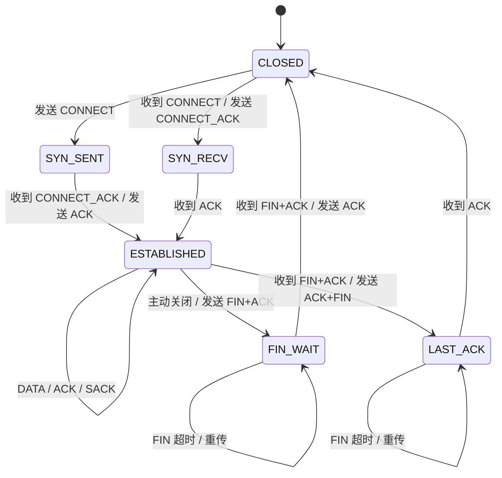

# SCP（Simple Stream Control Protocol）

[English README](../../README.md)

SCP 是一个构建在 UDP 或其他不可靠分组传输之上的轻量级可靠字节流协议。项目定位是网络传输研究：通过可检查的 C 实现，探索可靠传输、拥塞控制、pacing 与连接行为。

SCP 不依赖内核 TCP 栈，自行实现序号、ACK/SACK、重传、流量控制、连接管理、RTT/RTO 估计和拥塞控制。目前提供两种可切换的拥塞控制器：

- **SCP-PROB**：实验性的非线性控制器，将丢包和 RTT 证据转换为连续的拥塞似然信号。
- **AIMD**：采用传统加性增大、乘性减小的拥塞控制器，也用于对照实验。

当前版本还加入了发送端 pacing 层：拥塞窗口允许发送的数据会根据 `cwnd` 和 RTT 分配发送时间，再由 pacing 定时器释放。

> **项目状态：** SCP 仍在开发中，API 和线格式可能变化。传输协议核心与可选拥塞控制器分别评估；PROB 的具体实验结果见下文。

## 研究论文

概率驱动控制器的理论见：[SCP-PROB：概率驱动的非线性拥塞控制](../../SCP-PROB_Probability-Driven_Nonlinear_Congestion_Control.pdf)。

Pacing 研究见：[Pacing and Congestion-Window Growth: An Exact Packet-Level Analysis](../../Pacing_and_Congestion_Window_Growth.pdf)。论文分析明确规定的逐 ACK 追加调度器，不等同于当前 SCP 实现。[Pacing_and_Congestion_Window_Growth.tex](../../papers/pacing/Pacing_and_Congestion_Window_Growth.tex) 是唯一论文源码，直接上传 Overleaf 并使用 pdfLaTeX 编译即可；证明、参考文献和公式绘制的图均包含在其中，不依赖实验包或外部图片。

## 特性

- 在不可靠分组传输之上提供可靠字节流
- 序号、累计 ACK 和 SACK 信息
- 乱序缓存与重传
- 接收端通告窗口
- RTT、RTT 方差和重传超时估计
- CONNECT/FIN 连接生命周期
- 可切换的拥塞控制回调
- 可切换的 PROB 和 AIMD 拥塞控制器
- 基于 `cwnd / RTT` 的发送端 pacing
- 使用红黑树管理定时器和乱序接收缓存
- 保持可阅读、可移植的小型 C 实现

## 仓库结构

```text
scp.c / scp.h                  协议核心
lib/                           侵入式容器和基础数据结构
test/common/                   共用传输逻辑与真实 UDP 运行器
test/virtual/                  虚拟网络、功能测试与参数扫描
test/run.py                    双端传输、校验与结果保存
test/plot.py                   绘图入口与扫描总览
test/analyze_scp.py / fig.py    原状态日志分析器与论文绘图脚本
.github/workflows/             Linux 传输与虚拟网络 CI
setup_scp_netns.sh             Linux 网络命名空间拓扑
papers/pacing/                 pacing 论文源码
docs/                          使用文档
```

## 连接状态机



## 拥塞控制与 pacing

### SCP-PROB

SCP-PROB 将平滑丢包估计与 RTT 测量结合，构造残差拥塞信号，通过校准的 sigmoid 和滞回机制决定非线性控制律增加还是减少窗口。

其设计目标是在有丢包或变化的网络环境中传输数据。在下文记录的 0% 随机丢包配置中，两条 PROB 流分配不均，PROB 与 AIMD 竞争时获得的份额很小。这些观测针对所测 PROB 控制器及配置，不能据此判断 AIMD 控制器或 SCP 的可靠传输机制失效。

### AIMD

AIMD 是可独立选择的拥塞控制器，采用传统的加性增大和乘性减小。它与 SCP-PROB 使用相同的拥塞控制接口，但有自己的窗口更新规则，同时用于下文的对照实验。

### Pacing

pacing 不替代拥塞窗口：

1. `cwnd` 和对端窗口决定允许进入网络的数据量；
2. 发送端根据当前 RTT 和拥塞窗口计算逐包间隔；
3. 按递增方式为数据包分配计划发送时间；
4. 1 ms pacing 定时器发送所有已经到期的数据包。

当计算间隔小于 1 ms，或者用户态进程唤醒较晚时，同一个 tick 可以释放多个包。pacing 集成测试测量的是真实 transport `send` 回调时刻，不是数据经过 qdisc 后的物理链路离开时刻。

### Pacing 讨论记录

分析关注的是 pacing 如何改变 ACK 时序和窗口增长，以及 pacing 系数如何影响这一过程。相关 ICCRG 邮件记录了研究中涉及的问题和实现细节：

- [慢启动时序与比较模型](https://mailarchive.ietf.org/arch/msg/iccrg/K0LZfeCUDnp3Kj91dMx-0iPGef8/)，涉及[固定批次与逐 ACK 调度的区别](https://mailarchive.ietf.org/arch/msg/iccrg/GSzlNebpiu6Gp1UTRZJISBRiIi8/)，以及[窗口限制与 pacing 速率限制的关系](https://mailarchive.ietf.org/arch/msg/iccrg/6K-oKt8LfaaH1XQKzp62wfElujc/)。
- [Linux 为什么在慢启动中采用 2 倍 pacing 速率](https://mailarchive.ietf.org/arch/msg/iccrg/ms7Nww2LvUBuDaUmOD71osmp8bI/)：[Neal Cardwell 的回复](https://mailarchive.ietf.org/arch/msg/iccrg/ERsHqvYQLs7cNCxOPw13U5Jl9sg/)提供了 paced/unpaced CUBIC 时序图和 BBR Startup gain 推导；[后续问题](https://mailarchive.ietf.org/arch/msg/iccrg/a59n7DRXZr4q6it_djAZh23wuas/)继续讨论连续模型算出 `2 ln 2` 所依赖的假设，以及它与 Linux 系数 2 的关系。

## 编译与测试

全部测试通过一份 CMake 配置构建。真实 UDP 和虚拟网络共用数据生成、收发、校验与关闭流程；生成数据模式无需准备载荷文件，真实 UDP 也支持文件传输。

```sh
cmake -S test -B test/build -DCMAKE_BUILD_TYPE=Release
cmake --build test/build -j
ctest --test-dir test/build --output-on-failure
python3 test/run.py test/build/scp_udp --out test/results/udp-1g
```

独立传输默认测试 1 GiB。依赖安装、文件传输、网络扫描和公平性测试见 [测试说明](../../test/README.md)。

### 当前测试体系

- **功能与完整性检查：**CTest 注册了 12 项检查，覆盖连接生命周期、控制包丢失、分配失败、关闭、生成数据与文件传输、PROB/AIMD 运行、pacing 观测和双流冒烟检查。
- **共用传输逻辑：**真实 UDP 与虚拟网络使用同一套传输实现。生成数据逐字节校验并核对流校验和；文件传输额外核对长度与 SHA-256。双方都必须完成关闭。
- **Linux 与虚拟传输：**GitHub Actions 运行 CTest、1 GiB 虚拟传输及 Linux localhost UDP 上的 1 GiB 文件传输。localhost 未施加 WAN 带宽或延迟限制；Linux 网络命名空间提供另一套受控网络环境。
- **网络场景扫描：**默认 CI 执行 150 组虚拟测试：三种 100 Mbps 场景，基础 RTT 分别为 10、50、200 ms，十档 0% 至 5% 的独立随机丢包、五个种子，每组 64 MiB。手动选择 `scenarios-1g` 可运行 36 组 1 GiB 测试。这些是配置出的仿真条件；简化 Wi-Fi 场景不模拟竞争与链路层重试。
- **可检查的结果：**每种参数、每条连接分别保存协议栈状态日志与原分析器生成的曲线。报告保留失败项和成功运行的有效吞吐统计。CI 产物为 `transfer-1g-curves` 与 `network-report`。

这些测试为实际覆盖的配置提供证据，不证明协议在所有网络条件下正确，也不能把仿真结果当成真实链路测量。

### 测试架构与环境

测试框架把传输负载与分组投递分开。两个后端都运行实际 SCP 核心，并复用 `test/common/transfer.c` 的数据生成、接收校验、校验和交换与关闭流程。虚拟后端使用带种子的分组调度器和模拟时钟；UDP 后端使用 socket 与真实时间。Python 运行器协调执行、保留诊断结果，并调用原绘图脚本分析协议栈自己的 JSON 日志。[测试设计与环境说明](../../test/README.md#test-design-and-environments)介绍各层职责与通过标准。

| 环境 | 检查的内容 |
|---|---|
| 虚拟网络 | 可重复的速率、传播延迟、随机丢包和协议事件，无需等待真实时间 |
| Localhost UDP | 真实 socket、Linux/Windows 进程调度、双端运行与文件 I/O |
| Linux 网络命名空间 + netem | 受控客户端—路由器—服务器路径上的真实 Linux UDP/IP 与 qdisc 行为 |
| 实际中国到美国链路 | 真实跨洲路径的使用经历，与配置出的虚拟场景分别记录 |

此前 netem 实验采用 `scp-c ↔ scp-r ↔ scp-s`，在路由器两个出口分别配置 netem qdisc，每个方向独立施加速率、单向延迟、随机丢包和有限包队列。下文历史结果使用每方向 5 Mbit/s、单向 50 ms 延迟（空载 RTT 约 100 ms）、1000 包队列、100 MiB 传输与 300 秒公平性测量。这是在真实 Linux 网络上施加模拟链路条件，不能复现互联网路径的所有特征。当前 CI 的 localhost 传输没有应用这套 netem 拓扑，虚拟模型也没有有限队列，各环境结果应分别报告。

Linux 网络命名空间测试，先建立拓扑，再在两个终端中分别启动 B、A：

```sh
sudo bash setup_scp_netns.sh
sudo ip netns exec scp-s test/build/scp_udp B
sudo ip netns exec scp-c test/build/scp_udp A 10.0.2.1
```

## 早期验证记录

以下结果来自 **2026-08-19** 的一次真实运行，只是透明记录，不是多轮基准测试，也不代表普遍性能结论。

环境：

```text
双向速率：        每方向 5 Mbit/s
单向延迟：        50 ms
预期 RTT：        约 100 ms
队列上限：        1000 包
文件大小：        100 MiB
公平性测量时间：  300 秒
```

### 0% 随机丢包

| 测试 | 观测结果 |
|---|---|
| PROB 单流 | 接收端有效吞吐 4.686 Mbit/s |
| AIMD 单流 | 接收端有效吞吐 4.746 Mbit/s |
| pacing | 校验 8 MiB；发送回调平均间隔 2.200 ms；同一毫秒最多观测到 4 个 DATA 包 |
| PROB 对 PROB | 总有效吞吐 4.735 Mbit/s；Jain 指数 0.641；流量比 6.95:1 |
| PROB 对 AIMD | 总有效吞吐 3.421 Mbit/s；Jain 指数 0.504；PROB 仅获得接收字节的 0.36% |

100 MiB 文件通过了端到端哈希校验。

### 10% 随机丢包

| 测试 | 观测结果 |
|---|---|
| PROB 对 PROB | 总有效吞吐 2.044 Mbit/s；Jain 指数 0.999887；流量比 1.022:1 |

在这次快照中，两条 PROB 流在 10% 随机丢包下分配接近均衡，在 0% 随机丢包下分配不均；有丢包时的总有效吞吐较低。PROB 的分配行为及其与 AIMD 的共存仍需进一步研究。表格中的控制器吞吐、公平性测量，与传输层的文件完整性检查分别记录。

测试输出中的 `"status":"success"` 记录测试执行成功，并通过相应的协议或完整性检查；吞吐和公平性作为独立指标报告。

## 日志与曲线

测试构建默认启用协议栈自己的 JSON 状态打印，每条连接每 100ms 一次。`test/run.py` 自动保存日志并生成曲线。Linux 文件传输与虚拟网络分别运行：

```sh
sudo python3 test/run.py test/build/scp_udp --netns --file testA.bin --timeout 3600 --out test/results/linux-file
python3 test/run.py test/build/scp_virtual --backend virtual --out test/results/virtual-1g
```

文件测试需要先建立网络拓扑，结果包含 B 写出的 `received.bin`、双方日志、曲线及文件 SHA-256 核对。绘图需要 matplotlib，完整命令见 [测试说明](../../test/README.md)。

## 研究用途与使用经历

据作者记录，SCP 不仅用于 Linux 协议栈与网络实验，也曾在中国到美国的实际跨洲链路上传输 100 MB 大文件，还有版本在 20 KB 内存的单片机上使用过。仓库中也积累了大量自动化传输测试。这些经历对应特定版本与环境；单片机使用经历不代表当前版本保证满足该内存预算，真实跨洲传输也与上面的虚拟场景扫描分别记录。

如果你是喜欢折腾网络的 geek，欢迎尝试 SCP、观察行为，并一起讨论。项目希望为传输机制研究与设计比较提供实验空间。若你在做对可靠性、安全、维护或互操作有严格要求的产品，可以考虑 lwIP、QUIC 实现、KCP 等方案，并按产品需求评估。

SCP 仍处于实验阶段：API 与线格式可能变化，不兼容 TCP，核心不提供认证或加密。上面的历史 PROB 数据仍留下流量分配与共存问题。自动化测试、代码审查和数学分析各自提供不同的证据。

## 贡献与讨论

欢迎提交 [Issue](https://github.com/skaiui2/SCP/issues)，交流问题、实验结果、缺陷与设计思路。可复现报告请附提交版本、操作系统与构建命令、控制器、传输大小、网络参数或虚拟种子、预期与实际行为，以及相关日志。请明确区分真实网络测量和仿真。

涉及核心算法或 API 的提案，建议先在 Issue 中讨论目标行为与具体方案。请阅读 [AGENTS.md](../../AGENTS.md) 和 [项目贡献规则](../../FUCKAI/SKILL.md)，尤其是 AI 辅助工作的约束。提交 [Pull Request](https://github.com/skaiui2/SCP/pulls) 时保持修改聚焦，说明改了什么、原因以及实际执行的检查和结果，交由作者审核。运行相关 CTest 检查；网络或性能结论应附配置、日志与每条连接的曲线。

## AI 辅助声明

作者 **Skai Uijing** 对本项目的人与 AI 分工作如下说明：

- **协议代码：**`scp.c` 和 `scp.h` 基本由作者编写，AI 辅助审核和检查错误，也参与了 pacing 机制的辅助工作。
- **测试与绘图：**测试代码基本由 AI 生成，包括大文件传输等测试，作者检查其合法性与适用性；画图脚本也由 AI 生成。
- **SCP-PROB 论文与控制设计：**概率驱动设计、残差算法以及本项目中的 AIMD 控制环设计由作者完成，这不表示作者发明了 AIMD 本身。AI 提供论文翻译、编写帮助，并辅助检查了部分数学论证，例如贝叶斯推导与公平性分析；这些辅助检查不等于相关结论已获证明。
- **Pacing 研究：**作者提出了三明治比较模型，以及 pacing 系数很大时趋近于 burst、过小时会拖慢窗口增长的思路。作者进一步提出研究是否存在一个系数，既不拖慢窗口增长，也不让数据包发送越来越集中。这是分析的出发点，不是对所有 pacer 都成立的普遍保证。
- **后续建模与推导：**采用微分方程分析、把模型表示为速率等方法，以及上述作者思路之外的其他扩展分析，由 GPT 6 ASTRA 提出。由于生成内容较多，作者尚未逐项独立验证这些分析与推导。请读者仔细判断其假设、证明和适用范围，包括 pacing 论文中的相关内容；AI 的检查不能代替作者验证或独立审查。

本 README 使用 AI 辅助编辑。报告的实验测量来自运行日志和文件完整性检查，而不是 AI 生成的断言。代码审查、实验证据与数学结论的验证是不同的工作，不能相互替代。

## 许可证

SCP 使用 [MIT License](../../LICENSE)。
