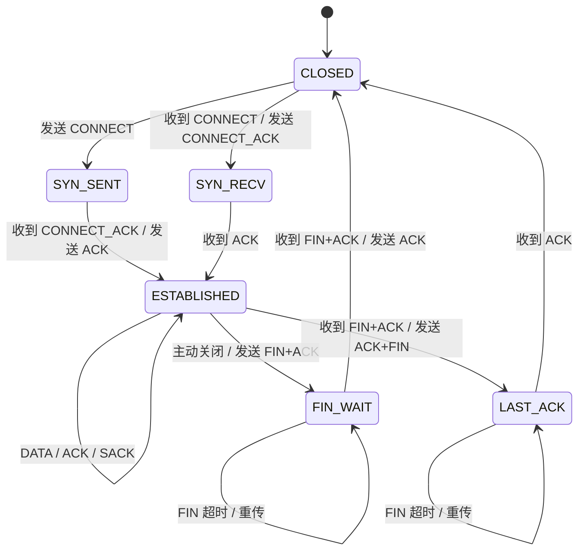

# SSCP（Simple Stream Control Protocol）

[English README](../../README.md)

SSCP 是一个使用纯 C 语言编写、构建在 UDP 之上的紧凑型流式可靠传输协议。无需依赖操作系统内核 TCP 栈或外部三方库，提供完整的可靠传输、流量控制、连接管理、拥塞控制与 Pacing 调度能力。

## 动机

为什么我要写这个项目呢？有的时候只是一个很小的想法，回过头来已经走了很远很远。

最开始，我只是觉得 TCP 太过于臃肿，而像 AIMD 这种仅依靠丢包作为信号的做法 very bad，我觉得我可以做得更好，所以我开始了对网络传输的研究，hahaha！也许我设计不出更好的传输协议，不过探索本身就是一种乐趣！hhha！Just for fun.

## 真实场景实测与实验背景 (Real-World & Experimental Validation)

SSCP 与底层链路严格解耦，我在很多场景进行了大量测试和实验：

- **单片机**：在早期版本中，我曾把协议移植到仅有 20 KB SRAM 的 STM32F103C8T6 单片机上。坦白说，在单片机上跑这种带完整窗口控制与重传状态机的流协议完全是大炮打蚊子，但当时我就是想试试它究竟能不能跑起来。结果效果意外不错，不仅可以跑，还可以跑我写的操作系统和编程语言，后来甚至在我的另一个单片机分布式项目中直接用来传输数据，表现非常丝滑。
- **真实跨洋广域网实测**：在中国本地机器与美国的一台公网 VPS 之间互传 100 MB 大文件，我进行了多次实验，测试数据传输完整性和性能。
- **Linux Netem 高强度压力测试**：在 Linux 网络命名空间中利用 `netem` qdiscs 搭建了包含带宽瓶颈、往返延迟（RTT）与随机丢包的严格拓扑，进行了数百 MB 乃至 1 GiB 级别的大规模高强度数据传输测试。

## 特性

- 基于不可靠分组传输提供严格保序的可靠字节流
- 序列号机制、累计确认与选择性确认（SACK）
- 乱序缓冲重组与超时重传
- 接收窗口流量控制
- 平滑 RTT、RTT 方差统计与动态 RTO 估算
- 完整的 CONNECT 三次握手与 FIN 连接生命周期管理
- 可插拔拥塞控制机制：SSCP-PROB（非线性概率估计）与 AIMD 基准
- 基于 `cwnd / RTT` 的发送端 Pacing 速率平滑
- 基于侵入式红黑树的高效定时器与乱序队列管理
- 纯 C 语言实现，无第三方运行时依赖

## 连接状态机



## 拥塞控制与 Pacing

- **SSCP-PROB**：综合平滑丢包率与 RTT 膨胀程度生成连续的拥塞似然信号，驱动平滑的非线性窗口增减。
- **AIMD**：标准加性增大、乘性减小拥塞控制器，作为基准对比。
- **Pacing**：在拥塞窗口允许发送的情况下，根据 RTT 与 cwnd 为每个数据包计算离散间隔并由定时器调度，发送队列空闲时持久保留尾槽，避免突发注入。

## 快速上手

### 1. 编译构建

```sh
cmake -S test -B test/build -DCMAKE_BUILD_TYPE=Release
cmake --build test/build -j
```

### 2. 运行自动化测试

```sh
# 虚拟网络完整测试套件 (11/11 项)
ctest --test-dir test/build -L virtual --output-on-failure

# 真实本地回环 UDP 传输
python3 test/run.py test/build/sscp_udp --bytes 8388608 --out test/results/udp-test
```

### 3. Linux 命名空间网络损耗测试

```sh
# 建立拓扑：5 Mbps 带宽，50 ms 单向延迟 (100 ms RTT)，10% 随机丢包
sudo bash setup_sscp_netns.sh setup 5mbit 50ms 10% 1000

# 终端 1（服务端 B）：
sudo ip netns exec sscp-s test/build/sscp_udp B 10.0.2.1 104857600 aimd

# 终端 2（客户端 A）：
sudo ip netns exec sscp-c test/build/sscp_udp A 10.0.2.1 104857600 aimd

# 销毁拓扑
sudo bash setup_sscp_netns.sh teardown
```

### 4. 使用 jPlot 可视化 Trace

jPlot 来自 Sebastian Moeller 的推荐，是一个非常好用的工具。我在使用 xplot 时遇到了很多麻烦，强烈建议大家使用 jPlot！

```sh
python3 test/sscptrace.py test/results/udp-test -o test/results/udp-test/trace.xpl
java -jar jPlot.jar test/results/udp-test/trace.xpl
```

## 相关文档

- User Guide (English): [docs/English/UserGuide.md](../English/UserGuide.md)
- 使用手册 (中文): [docs/中文/使用手册.md](使用手册.md)
- Testing Guide (English): [test/README.md](../../test/README.md)
- 测试说明 (中文): [docs/中文/测试说明.md](测试说明.md)
- README (English): [README.md](../../README.md)

## 参与贡献

欢迎通过 Issue 与 Pull Request 报告缺陷、提出建议或参与协议设计讨论。

## 许可证

SSCP 遵循 [MIT 许可证](../../LICENSE) 开源。
